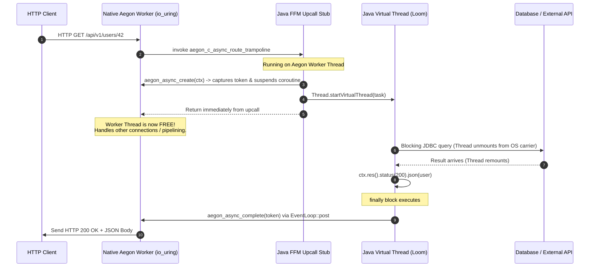
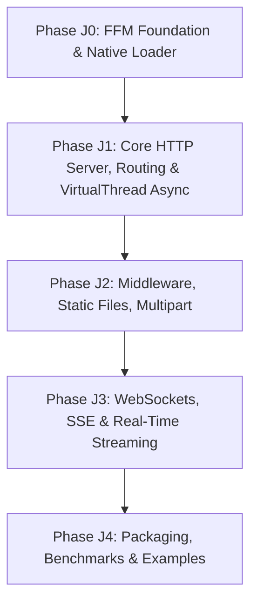

# Aegon Java Bindings via Foreign Function & Memory (FFM) API
## Architectural Blueprint & Phased Execution Plan

---

## 1. Executive Summary & Core Objective

The goal of this project is to create the official, high-performance Java bindings for **Aegon**, powered by **Java 22+ Foreign Function & Memory (FFM) API ([JEP 454](https://openjdk.org/jeps/454))** and **Project Loom Virtual Threads**.

Rather than relying on legacy Java Native Interface (JNI) with its bulky native C wrappers, fragile pointer passing, and JNI transition overhead, the Aegon Java bindings leverage modern Java FFM primitives:
- **Direct JIT-intrinsified downcalls (`MethodHandle`)** directly into `libaegon_c.so` / `aegon_c.dll`.
- **Zero-copy off-heap memory views (`MemorySegment`)** referencing Aegon's socket receive buffer without intermediate JVM heap allocations.
- **Deterministic lifecycle management** via scoped arenas (`Arena.ofConfined()`).
- **Native-to-Java upcalls (`Linker.upcallStub`)** for high-throughput HTTP route handlers and session callbacks.
- **Automated Project Loom (Virtual Thread) Dispatch**: When registering asynchronous routes (`getAsync`, `postAsync`, `delAsync`, etc.), the Aegon Java runtime **automatically** spawns a lightweight Java Virtual Thread and suspends/resumes the native Aegon coroutine via `aegon_async_create` and `aegon_async_complete`. Developers write clean, blocking Java code (JDBC, JPA, HTTP clients, files) with **zero Loom boilerplate and zero manual token management**, while the native Aegon `io_uring` worker threads remain 100% non-blocking.
- **Exact Documentation Syntax Parity**: Handlers match Aegon's official documentation (`docs/content/docs/`): single `Context ctx` parameter, `ctx.req()`, `ctx.res()`, `ctx.problem()`, `router.del()`, and recursive route groups.

```mermaid
flowchart TD
    subgraph Java Application Layer
        UserApp["Java Web App (Java 22+ / 25 GraalVM)"]
        subgraph AegonJavaAPI ["io.aegon: Fluent High-Level API (Docs Syntax)"]
            Router["Router & RouteGroups (del, get, post, getAsync...)"]
            Context["Context (ctx.req(), ctx.res(), ctx.problem())"]
            LoomBridge["Automated VirtualThread Dispatcher"]
        end
    end

    subgraph Java FFM Bridge Layer (JEP 454)
        NativeBindings["io.aegon.internal.ffi: MethodHandles & FunctionDescriptors"]
        ArenaMem["MemorySegment & Scoped Arenas (Zero-Copy)"]
    end

    subgraph Native Aegon Engine
        LibAegonC["libaegon_c.so (C11 ABI)"]
        AsyncBridge["aegon_async_create / aegon_async_complete"]
        CoreEngine["io_uring / epoll / IOCP Thread-Per-Core Core"]
    end

    UserApp --> Router
    Router --> Context
    Router --> LoomBridge
    Context --> NativeBindings
    LoomBridge --> NativeBindings
    NativeBindings --> ArenaMem
    NativeBindings -->|Direct MethodHandle Downcall| LibAegonC
    LibAegonC -->|Upcall Stub Execution| NativeBindings
    LoomBridge -->|Suspend & Resume Coroutines| AsyncBridge
    LibAegonC --> CoreEngine
```

---

## 2. API Design & Syntax Alignment with Official Aegon Docs

The Java API strictly mirrors the developer ergonomics and syntax defined in Aegon's official documentation (`docs/content/docs/`):

### 2.1 Overview: C++ Docs vs. Java FFM Equivalent

| Feature | Aegon C++ (`docs/content/docs/`) | Aegon Java (`io.aegon.*`) |
| :--- | :--- | :--- |
| **Handler Signature** | `[](http::Context& ctx)` | `ctx -> { ... }` (`Handler` interface) |
| **Request Access** | `ctx.req().method()`, `ctx.req().param("id")` | `ctx.req().method()`, `ctx.req().param("id")` |
| **Response Builder** | `ctx.res().status(200).text("OK")` | `ctx.res().status(200).text("OK")` |
| **JSON Serialization** | `ctx.res().json(obj)` | `ctx.res().json(recordOrDto)` |
| **JSON Deserialization** | `ctx.req().json<T>()` / `ctx.bind_json<T>()` | `ctx.req().json(MyDto.class)` / `ctx.bindJson(MyDto.class)` |
| **Delete HTTP Verb** | `router.del(path, handler)` | `router.del(path, handler)` *(also `router.delete` alias)* |
| **Route Groups** | `auto v1 = router.group("/api/v1");` | `RouteGroup v1 = router.group("/api/v1");` |
| **RFC 7807 Errors** | `ctx.problem(StatusCode::NotFound, ...)` | `ctx.problem(StatusCode.NOT_FOUND, ...)` |
| **Static Files** | `ctx.send_file("path")` | `ctx.sendFile("path")` |
| **Per-Request State** | `ctx.set<T>(val); ctx.get<T>();` | `ctx.set("key", val); ctx.get("key");` |
| **Sync Execution** | `void(Context&)` (fast path, 0 coroutines) | `router.get(path, ctx -> { ... })` (inline on native worker) |
| **Async Execution** | `Task<void>(Context&)` (`co_await`) | `router.getAsync(path, ctx -> { ... })` (**Auto VirtualThread**) |

---

## 3. The Dual-Mode Execution Model

Aegon's signature architectural strength is its dual-mode routing engine (`docs/content/docs/http/routing-groups.mdx`):
1. **Synchronous Fast-Path**: 0 coroutine allocations, 0 task state machine overhead, executes directly on the reactor thread.
2. **Asynchronous Non-Blocking Path**: Coroutines (`Task<void>`) when I/O operations must be awaited.

In Aegon Java, we map this distinction naturally to the JVM:

### 3.1 Synchronous Routes (Reactor Inline Fast-Path)
For compute-bound operations, in-memory lookups, or cached JSON responses, synchronous routes execute directly within the native worker's thread context via JIT-optimized FFM upcalls:
```java
// Fast-path: 0 thread switching, 0 VirtualThread allocations, runs inline on Aegon worker
router.get("/health", ctx -> {
    ctx.res().status(StatusCode.OK).text("OK");
});

router.get("/pipeline", ctx -> {
    ctx.res().text("ok");
});
```
*Capable of sustaining 10M+ requests per second with sub-millisecond latencies.*

### 3.2 Asynchronous Routes (Automated VirtualThread Dispatch)
For any route that performs blocking operations (JDBC/JPA database queries, HTTP client requests, file I/O, Redis calls, gRPC), the developer simply registers an async route (`getAsync`, `postAsync`, `putAsync`, `patchAsync`, `delAsync`, `allAsync`):

```java
// Asynchronous: Automatically dispatches to a Java Virtual Thread!
// The Aegon native worker thread suspends the coroutine immediately and remains free.
router.getAsync("/api/v1/users/:id", ctx -> {
    String userId = ctx.req().param("id").orElseThrow();

    // Standard synchronous, blocking JDBC code — completely safe on Virtual Threads!
    User user = database.findUserById(userId);

    ctx.res().status(StatusCode.OK).json(user);
});
```

#### What Happens Under the Hood (Zero-Boilerplate Loom Bridge)
The developer writes standard, synchronous code. The Aegon Java runtime transparently handles all coroutine lifecycle mechanics:



1. **Native Route Invocation**: Aegon receives the request and enters `aegon_c_async_route_trampoline` on the worker thread.
2. **Native Coroutine Suspension**: The Java dispatcher calls `aegon_async_create(ctx, null, null)`, producing an opaque `aegon_async_t*` token.
3. **Virtual Thread Spawning**: The dispatcher launches a Java Virtual Thread:
   ```java
   Thread.ofVirtual().name("aegon-vt-" + requestId).start(() -> {
       try {
           userHandler.handle(ctx);
       } catch (Throwable ex) {
           // Global Exception Boundary: Map to RFC 7807 500 JSON
           handleException(ctx, ex);
       } finally {
           // Thread-safely post completion back to Aegon worker EventLoop
           AegonFfi.aegon_async_complete(token);
       }
   });
   ```
4. **Immediate Worker Return**: The FFM upcall returns immediately to C++. The C++ coroutine executes `co_await suspend_token;`, leaving the native worker thread free to handle millions of other requests without stalling.
5. **Blocking I/O on Loom**: Inside the Virtual Thread, any blocking JDBC, HTTP, or file I/O causes Loom to unmount the virtual thread from its OS carrier thread.
6. **Automatic Resumption**: When the handler completes (or throws), the `finally` block invokes `aegon_async_complete(token)`. This uses `EventLoop::post` to wake the coroutine on its owning Aegon worker thread, which serializes `ctx.res()` and writes the response to the client socket.

---

## 4. Developer Experience & API Showcase

### 4.1 Complete REST Application Example
```java
package com.example;

import io.aegon.AegonServer;
import io.aegon.http.Context;
import io.aegon.http.StatusCode;
import io.aegon.http.RouteGroup;

public class Main {
    record CreateUserRequest(String username, String email) {}
    record UserResponse(long id, String username, String email, String status) {}

    public static void main(String[] args) {
        AegonServer server = AegonServer.create();

        // 1. Plaintext health check (Synchronous Fast Path)
        server.router().get("/health", ctx -> {
            ctx.res().status(StatusCode.OK).text("OK");
        });

        // 2. Hierarchical Route Groups
        RouteGroup api = server.router().group("/api/v1");

        // 3. Automated Virtual Thread Async Endpoint
        api.postAsync("/users", ctx -> {
            CreateUserRequest req = ctx.req().json(CreateUserRequest.class);
            if (req.username() == null || req.email() == null) {
                ctx.problem(StatusCode.BAD_REQUEST, "Bad Request", "Missing required fields", "/api/v1/users");
                return;
            }

            // Blocking database save on Virtual Thread
            long newId = Database.saveUser(req.username(), req.email());

            UserResponse res = new UserResponse(newId, req.username(), req.email(), "active");
            ctx.res().status(StatusCode.CREATED).json(res);
        });

        // 4. Path parameter extraction & delete verb
        api.del("/users/:id", ctx -> {
            String id = ctx.req().param("id").orElse("");
            ctx.res().status(StatusCode.NO_CONTENT);
        });

        // 5. Query parameter extraction
        api.get("/search", ctx -> {
            String query = ctx.req().query("q").orElse("");
            int limit = ctx.req().queryInt("limit", 20);
            ctx.res().text("Search query=" + query + ", limit=" + limit);
        });

        // 6. Start server on port 8080 across all CPU cores
        server.listen(8080, "0.0.0.0");
        System.out.println("Aegon Java server listening on http://0.0.0.0:8080");
        server.run(); // Launches thread-per-core cluster
    }
}
```

### 4.2 RFC 6455 WebSocket Service
Matches `docs/content/docs/http/websocket.mdx`:
```java
// Fast-path echo endpoint
server.router().wsEcho("/ws/echo");

// Interactive WebSocket connection handler
server.router().ws("/ws/chat", ws -> {
    ws.onOpen(conn -> {
        System.out.println("Client connected: " + conn.path());
        conn.sendText("Welcome to Aegon Chat!");
    });

    ws.onText((conn, text) -> {
        conn.sendText("Echo: " + text);
    });

    ws.onBinary((conn, data) -> {
        conn.sendBinary(data);
    });

    ws.onClose((conn, code, reason) -> {
        System.out.println("Client disconnected (" + code + "): " + reason);
    });
});
```

### 4.3 Server-Sent Events (SSE)
Matches `docs/content/docs/http/sse.mdx`:
```java
// Automatically runs inside a Virtual Thread for easy blocking streaming loops!
server.router().sse("/events/trades", (ctx, sse) -> {
    sse.retry(3000);
    sse.comment("connected");

    for (int i = 0; i < 100 && sse.isOpen(); i++) {
        Trade trade = market.nextTrade(); // blocking wait
        sse.event("trade", trade.toJson());
        Thread.sleep(100);
    }
    sse.close();
});
```

---

## 5. Low-Level FFM Implementation Mechanics (`io.aegon.internal.ffi`)

### 5.1 Linker & Function Descriptors
All C symbols are bound via standard Java 22+ FFM `Linker` and JIT-intrinsified `MethodHandle`:

```java
package io.aegon.internal.ffi;

import java.lang.foreign.*;
import java.lang.invoke.MethodHandle;

public final class AegonFfi {
    private static final Linker LINKER = Linker.nativeLinker();
    private static final SymbolLookup SYMBOLS = NativeLibraryLoader.lookup();

    // Struct Layout: aegon_str_t { const char* data; size_t len; }
    public static final StructLayout STR_LAYOUT = MemoryLayout.structLayout(
        ValueLayout.ADDRESS.withName("data"),
        ValueLayout.JAVA_LONG.withName("len")
    );

    // Method Handles
    public static final MethodHandle MH_aegon_router_create = downcall("aegon_router_create", 
        FunctionDescriptor.of(ValueLayout.ADDRESS));
    
    public static final MethodHandle MH_aegon_router_add_route = downcall("aegon_router_add_route",
        FunctionDescriptor.of(ValueLayout.JAVA_INT,
            ValueLayout.ADDRESS, ValueLayout.JAVA_INT, ValueLayout.ADDRESS,
            ValueLayout.ADDRESS, ValueLayout.ADDRESS, ValueLayout.ADDRESS));

    public static final MethodHandle MH_aegon_router_add_async = downcall("aegon_router_add_async",
        FunctionDescriptor.of(ValueLayout.JAVA_INT,
            ValueLayout.ADDRESS, ValueLayout.JAVA_INT, ValueLayout.ADDRESS,
            ValueLayout.ADDRESS, ValueLayout.ADDRESS, ValueLayout.ADDRESS));

    public static final MethodHandle MH_aegon_async_create = downcall("aegon_async_create",
        FunctionDescriptor.of(ValueLayout.ADDRESS, ValueLayout.ADDRESS, ValueLayout.ADDRESS, ValueLayout.ADDRESS));

    public static final MethodHandle MH_aegon_async_complete = downcall("aegon_async_complete",
        FunctionDescriptor.of(ValueLayout.JAVA_INT, ValueLayout.ADDRESS));

    public static final MethodHandle MH_aegon_res_set_status = downcall("aegon_res_set_status",
        FunctionDescriptor.of(ValueLayout.JAVA_INT, ValueLayout.ADDRESS, ValueLayout.JAVA_INT));

    public static final MethodHandle MH_aegon_res_set_body_text = downcall("aegon_res_set_body_text",
        FunctionDescriptor.of(ValueLayout.JAVA_INT, ValueLayout.ADDRESS, STR_LAYOUT));

    public static final MethodHandle MH_aegon_res_set_body_json = downcall("aegon_res_set_body_json",
        FunctionDescriptor.of(ValueLayout.JAVA_INT, ValueLayout.ADDRESS, STR_LAYOUT));

    private static MethodHandle downcall(String name, FunctionDescriptor desc) {
        return LINKER.downcallHandle(SYMBOLS.find(name).orElseThrow(() -> 
            new UnsatisfiedLinkError("Symbol not found: " + name)), desc);
    }
}
```

### 5.2 Zero-Copy Inbound Memory Slicing
Incoming request bodies and route parameters are read zero-copy directly from off-heap memory:

```java
public final class Request {
    private final MemorySegment reqPtr;

    public MemorySegment bodySegment() {
        // Calls aegon_req_get_body(reqPtr) returning aegon_str_t
        MemorySegment strSeg = AegonFfi.reqGetBody(reqPtr);
        MemorySegment dataPtr = strSeg.get(ValueLayout.ADDRESS, 0);
        long len = strSeg.get(ValueLayout.JAVA_LONG, ValueLayout.ADDRESS.byteSize());
        if (dataPtr.equals(MemorySegment.NULL) || len <= 0) return MemorySegment.NULL;
        return dataPtr.reinterpret(len);
    }

    public String body() {
        MemorySegment segment = bodySegment();
        if (segment.equals(MemorySegment.NULL)) return "";
        return segment.getString(0, StandardCharsets.UTF_8);
    }
}
```

---

## 6. Phased Implementation Roadmap



### Phase J0 — FFM Foundation & Native Loader
- Create repository directory `bindings/java/` with Gradle (Kotlin DSL) and Maven support (`pom.xml` / `build.gradle.kts`).
- Implement `NativeLibraryLoader`: automatically resolves and loads `libaegon_c.so` / `aegon_c.dll` from `java.library.path`, target build directories, or bundled JAR resources.
- Define core FFM constants, `StructLayout`, and raw downcalls (`aegon_abi_version`, `aegon_last_error`).
- Verification: Standalone Java test printing Aegon native ABI version.

### Phase J1 — Core HTTP Server, Routing & Automated VirtualThread Async
- Implement `io.aegon.AegonServer`, `io.aegon.http.Router`, `RouteGroup`, `Context`, `Request`, `Response`, `StatusCode`.
- Implement FFM Upcall stubs for synchronous route dispatch (`void handle(Context ctx)`).
- Implement automated **VirtualThread Async Dispatch** for `getAsync`, `postAsync`, `putAsync`, `patchAsync`, `delAsync`, `allAsync`.
- Implement RFC 7807 `ctx.problem(...)` and Global Exception Boundary.
- Comprehensive JUnit 5 test suite verifying CRUD routes, route parameters (`:id`), query params (`?k=v`), headers, cookies, and VirtualThread execution.

### Phase J2 — Middleware, Static Files & Multipart
- Middleware chain support: `router.use((ctx, next) -> { ... })`.
- Built-in middleware bindings: CORS, Security Headers, Access Logging, Compression (Gzip/Brotli/Zstd).
- Static file serving: `router.staticFiles(path, dir)` and `ctx.sendFile(path)`.
- Multipart form parsing (`req.multipart()`).

### Phase J3 — Real-Time Streaming (WebSocket & SSE)
- Implement `AegonWebSocket`, `wsEcho`, and connection callbacks (`onOpen`, `onText`, `onBinary`, `onClose`).
- Implement `AegonSseStream` with automatic VirtualThread execution for `router.sse(...)`.
- JUnit 5 integration tests for WebSockets and SSE event streaming.

### Phase J4 — Packaging, Maven Central & Performance Benchmarks
- Multi-platform JAR packaging containing native binaries for `linux-x86_64`, `linux-aarch64`, and `windows-x86_64`.
- HttpArena benchmark suite comparing Aegon Java against Spring Boot (Netty/Tomcat), Quarkus, and native C++ Aegon.
- Full sample apps (`examples/java/rest_crud`, `examples/java/chat_ws`, `examples/java/sse_ticker`).

---

## 7. Verification & Success Criteria

1. **Exact Doc Syntax**:
   - Every snippet in the documentation runs in Java with identical naming (`ctx.req()`, `ctx.res()`, `router.del()`, `group.get()`, `ctx.problem()`).
2. **Automated Loom Execution**:
   - Calling `router.getAsync(path, ctx -> { ... })` executes on `Thread.currentThread().isVirtual() == true`.
   - The native Aegon worker thread is freed immediately after `aegon_async_create`.
   - Zero manual token or thread manipulation required by the developer.
3. **No Memory Leaks**:
   - Zero leak of native memory segments or arenas during 1,000,000+ requests under load.
4. **All Tests Pass**:
   - 100% test pass rate across JUnit 5 suite and C ABI tests.